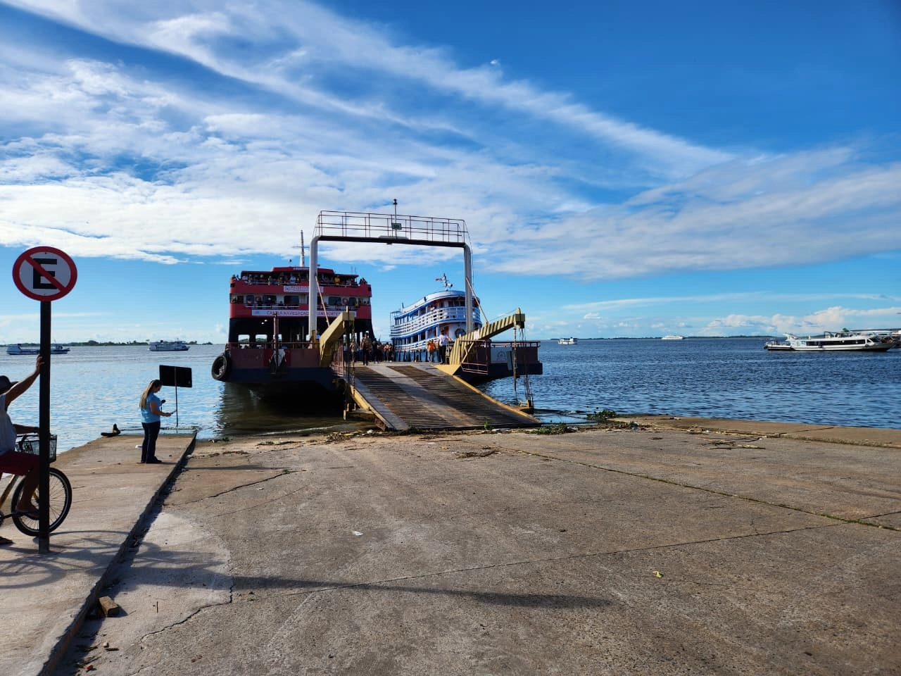

# Camila Navegação e Transportes



A Camila Navegação e Transportes realiza travessias fluviais de passageiros e veículos. Este site apresenta a empresa e reúne informações para quem deseja conhecer seus serviços.

## Escopo do site

- **Início:** apresenta a empresa, sua história, serviços, frota e reconhecimentos.
- **Travessias:** lista rotas e exibe detalhes e horários quando disponíveis.
- **Projetos sociais:** publica informações sobre as iniciativas da empresa.
- **Contato:** reúne canais para falar com a equipe.
- **Idiomas:** conteúdo disponível em português do Brasil e inglês dos Estados Unidos.

## Executar localmente

Requer Node.js e npm instalados.

```bash
npm install
npm run dev
```

Acesse [http://localhost:3000](http://localhost:3000).
